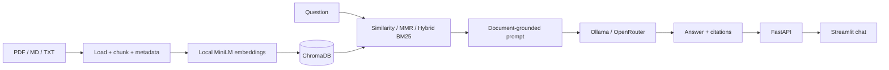

# 🦺 SafeSite Assistant Pro

**A source-grounded RAG chatbot for navigating construction-site workplace safety documents.**

SafeSite Assistant Pro is an educational, local-first document intelligence project built with **Python, LangChain, FastAPI, ChromaDB, local HuggingFace embeddings, and Ollama / OpenRouter**. It answers questions from your indexed documents and displays source excerpts and page numbers.

> **Disclaimer:** This is a software demonstration, not a safety authority or a substitute for approved site procedures, qualified supervisors or emergency services. All included examples are fictional.

## Features

- 🗂️ Upload and index PDF / TXT / Markdown documents, with page metadata and stable chunk IDs.
- 🔎 Compare **similarity**, **MMR**, and **hybrid BM25 + vector (RRF)** retrieval.
- 🎯 Restrict retrieval to one specific indexed document.
- 📖 Answer questions using document excerpts, show citations and excerpts; refuse unsupported requests.
- 🧩 FastAPI backend and Streamlit chat UI (separate processes).
- 🧪 Evaluation dataset (10 cases, including 2 unanswerable), retrieval metrics and latency measurement.
- 🔐 `.gitignore` excludes `.env`, user uploads, cache and local vector store.
- ✅ Unit tests, GitHub Actions CI, Dockerfile, typed request/response models.
- 🦙 **Ollama local mode** (no LLM API fees) or **OpenRouter `:free` model** (availability and usage limits vary).

## Architecture



See [docs/ARCHITECTURE.md](docs/ARCHITECTURE.md) for technical tradeoffs, limitations and evaluation details.

## Quickstart (Windows PowerShell)

Install **Python 3.11** and [Ollama](https://ollama.com/download). Open the repository folder in VS Code. Then:

```powershell
python -m venv .venv
.\.venv\Scripts\python.exe -m pip install -r requirements.txt
ollama pull llama3.2:3b
.\.venv\Scripts\python.exe ingest.py
.\.venv\Scripts\python.exe -m uvicorn api:app --reload
```

The local embedding model downloads on first ingestion. `nomic-embed-text` is **not** used by this project; embeddings use `sentence-transformers/all-MiniLM-L6-v2` locally.

In **a second VS Code terminal**, launch the chat UI:

```powershell
.\.venv\Scripts\python.exe -m streamlit run app.py
```

Open **http://localhost:8501**. FastAPI is at **http://localhost:8000/docs**.

To use OpenRouter rather than Ollama, copy `.env.example` to `.env`, set `LLM_PROVIDER=openrouter`, add a valid `OPENROUTER_API_KEY`, and confirm that the chosen `:free` model is available. Never commit or share your key. OpenRouter is not required for local mode.

## API example

```shell
curl -X POST http://localhost:8000/ask -H "Content-Type: application/json" -d '{"question":"Who coordinates site induction?","mode":"hybrid","k":4}'
```

Response format:

```json
{
  "answer": "... [01_site_induction.md, p.1]",
  "sources": [{"file":"01_site_induction.md","page":1,"excerpt":"..."}],
  "latency_ms": 1234,
  "retrieval_mode": "hybrid"
}
```

`latency_ms` above is an example placeholder, not an observed benchmark. `POST /ingest`, `GET /documents`, and `GET /health` are also available.

## Test your RAG

Try these prompts:

- *Who coordinates site induction?*
- *Which incident notification form should be used?*
- *When are the equipment administrative records reviewed?*
- *How much does the CEO earn?* (**should refuse**)
- *What is the precise maximum permitted scaffold load?* (**should refuse**)

The example policies are fictional. Do not rely on them for real workplace decisions.

## Evaluation and tests

```powershell
.\.venv\Scripts\python.exe -m pip install -r requirements-dev.txt
.\.venv\Scripts\python.exe -m pytest -q
.\.venv\Scripts\python.exe -m eval.run_eval --mode similarity
.\.venv\Scripts\python.exe -m eval.run_eval --mode mmr
.\.venv\Scripts\python.exe -m eval.run_eval --mode hybrid
```

Tests mock neither providers nor deployed services because they cover helpers and validation; integration testing needs a locally running Ollama and ingested documents. Evaluation metrics are **not precomputed** or claimed as proven. Inspect the generated `eval/results.local.json` and manually review failures.

## Project structure

```text
SafeSite-Assistant-Pro/
├── api.py                    # FastAPI endpoints
├── app.py                    # Streamlit chatbot
├── ingest.py                 # Reproducible ingestion script
├── safesite/
│   ├── config.py             # Typed .env settings
│   ├── engine.py             # Vector DB + grounded LLM chain
│   ├── ingestion.py          # PDF/TXT/MD extraction, chunking, IDs
│   └── retrieval.py          # Similarity, MMR, BM25+RRF
├── data/                     # Fictional example policies
├── docs/ARCHITECTURE.md      # Architecture and tradeoffs
├── eval/                     # 10 questions and evaluation runner
├── tests/                    # Unit/API smoke tests
├── .github/workflows/ci.yml  # CI on push and pull request
├── .env.example
├── .gitignore
├── requirements.txt
├── requirements-dev.txt
└── Dockerfile
```

## Future improvements

True answer faithfulness evaluation; re-ranking; streaming; question rewriting for follow-ups; structured citation validation; persistent sparse indexing; authentication and multi-tenant storage; file-type validation and malware scanning.

## License

MIT. See [LICENSE](LICENSE).
