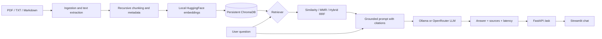

# Architecture and technical decisions

## Data flow



## Design decisions

- **Source grounding**: response prompts require `[file, p.X]` citations and document-only answers.
- **Embedding model**: MiniLM is local and compact; download needed on first use.
- **Local vector database**: Chroma persists on disk. Each re-ingested filename is replaced to avoid duplicate chunks.
- **Retrieval**: similarity, MMR, and hybrid (Chroma dense + in-memory BM25, fused with reciprocal-rank fusion).
- **Filtering**: `source` metadata selects a specific indexed file.
- **Metadata**: PDF page labels are 1-indexed when ingested. Non-PDF files use page 1 as an artificial page label.
- **Server separation**: RAG backend independent from HTTP endpoints and UI.
- **Privacy**: `.env`, local vector database and uploaded documents excluded from Git; README demo content is fictional.

## Important limitations

- Hybrid BM25 uses an **in-memory scan** of all Chroma documents per query, not suitable for very large datasets. Use a persistent keyword index for scale.
- Similarity retrieval can surface irrelevant text. A grounded prompt is not a guaranteed guard against hallucinations; verify references manually.
- The LLM may produce citations that do not exist in the retrieved source list; future work: programmatic citation verification.
- OpenRouter free models are rate-limited and may be changed or removed. Configured fallback only applies when a valid alternative is provided.
- Filename-based replacement isn't suited for multiple users uploading equal-named files; introduce tenant/workspace IDs and auth for multi-user deployment.
- FastAPI upload accepts common document extensions with a 15 MB limit but does not antivirus-scan or implement authentication. **Do not expose publicly without authentication, security controls and file validation.**
- Demo documents are **fictional and not operational safety guidance**. Always verify real safety requirements with official policies and supervisors.
- Ollama must run separately; the Dockerfile packages only the API, not the local model runtime.

## RAG evaluation

After `python ingest.py`, run:

```shell
python -m eval.run_eval --mode similarity --output eval/similarity.local.json
python -m eval.run_eval --mode mmr --output eval/mmr.local.json
python -m eval.run_eval --mode hybrid --output eval/hybrid.local.json
```

The demo evaluation contains 10 questions, of which 2 cannot be answered from source documents. `retrieval_hit_at_k` is document-level, not passage-level. `answer_inclusion_heuristic` is simplistic phrase matching, not full semantic accuracy. Review all answer outputs by hand. **No benchmark scores are claimed until evaluation is actually run.**
